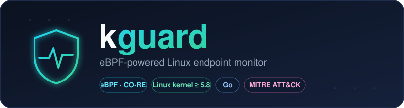

<div align="center">



<p>
  <b>Watch what really happens on your Linux boxes — from inside the kernel.</b><br>
  kguard taps eBPF to stream process, exec and network activity in real time, maps it to
  <a href="https://attack.mitre.org/">MITRE ATT&CK</a>, and alerts on attacker behavior.
</p>

<p>
  <a href="https://github.com/securewithharshitrajput/kguard/actions/workflows/ci.yml"></a>
  
  
  
  
  
</p>

<p>
  <a href="#-quickstart">Quickstart</a> ·
  <a href="#-what-it-detects">Detections</a> ·
  <a href="#-how-it-works">How it works</a> ·
  <a href="#-why-kguard">Why kguard</a> ·
  <a href="#-roadmap">Roadmap</a>
</p>

</div>

---

## 🔎 What is kguard?

Traditional log-based monitoring sees what applications *choose* to tell it. kguard sits one
level deeper — in the **kernel**, via [eBPF](https://ebpf.io/) — so it sees the ground truth:
every program that launches, every process that dies, every TCP connection that opens. It
filters the noise in-kernel, enriches each event with **who/what/where** context, and runs it
through a **data-driven rule engine** so you get *alerts*, not a firehose.

Think of it as a lightweight, hackable, open cousin of the behavioral engine inside commercial
EDR products — small enough to read in an afternoon, real enough to catch a reverse shell.

> [!IMPORTANT]
> **kguard is a defensive tool.** Run it only on systems you own or are authorized to monitor.
> It *observes* activity; it does not attack anything. Loading eBPF requires root (or
> `CAP_BPF` + `CAP_PERFMON`).

## ✨ Features

|  |  |
|---|---|
| 🧬 **Kernel-level process telemetry** | Every `execve` & exit — PID, PPID, UID, path, args |
| 🌐 **Network visibility** | Outbound (`tcp_connect`) and inbound (`inet_csk_accept`) IPv4 flows |
| 🧠 **Rich enrichment** | Username, container ID (Docker/containerd/K8s), SHA-256 of the binary, full process lineage |
| 📜 **YAML detection engine** | Add detections without recompiling — each mapped to MITRE ATT&CK |
| 📤 **Pluggable outputs** | Colorized console, newline-delimited JSON for your SIEM, Slack-style webhooks |
| 🪶 **Low overhead** | In-kernel filtering + a 256 KiB ring buffer; irrelevant events never reach user space |
| 🚀 **Portable (CO-RE)** | *Compile Once, Run Everywhere* via BTF — build on one kernel, run on others |

## ⚡ Quickstart

```bash
# 1. Install the toolchain (Fedora/RHEL)
sudo dnf install -y clang llvm bpftool libbpf-devel golang

#    …or Debian/Ubuntu
# sudo apt-get install -y clang llvm libbpf-dev linux-tools-common golang

# 2. Build (generates vmlinux.h, compiles the eBPF, builds the Go binary)
make build

# 3. Run it (needs root to load eBPF)
sudo ./bin/kguard run
```

Then, in a second terminal, fire the **harmless** demo triggers and watch the alerts light up:

```bash
./test/simulate.sh
```

## 🖥️ Sample output

```text
kguard 0.1.0 — loaded 10 rules from rules/default.yaml
kguard is running. Press Ctrl-C to stop.

EXEC  pid=48213 ppid=1322 user=www-data /usr/bin/curl [curl http://169.254.169.254/...]
CONN  pid=48213 comm=curl -> 169.254.169.254:80

>> ALERT [high] exec-from-tmp  T1059 | pid=48990 comm=xmr parent=bash user=www-data file=/tmp/.x/xmr
>> ALERT [high] webserver-spawns-shell  T1505.003 | pid=49001 comm=bash parent=nginx user=www-data file=/usr/bin/bash
>> ALERT [high] shell-makes-network-connection  T1059.004 | pid=49001 comm=bash user=www-data -> 10.0.0.9:4444
```

<details>
<summary><b>…and the same events as JSON (<code>--log kguard.jsonl</code>)</b></summary>

```json
{"time":"2026-10-14T15:52:03Z","rule":"webserver-spawns-shell","severity":"high","mitre":"T1505.003",
 "description":"A web server process launched an interactive shell.",
 "event":{"Kind":"exec","Pid":49001,"Ppid":1322,"Uid":33,"Comm":"bash",
          "Filename":"/usr/bin/bash","Username":"www-data","ParentComm":"nginx",
          "Ancestry":["nginx","systemd"],"ExeSHA256":"a1b2c3…"}}
```
</details>

## 🧭 How it works

```
            LINUX KERNEL                                 USER SPACE (Go)
 ┌───────────────────────────────┐        ┌────────────────────────────────────────┐
 │ eBPF programs (C)             │        │ kguard                                 │
 │                               │        │                                        │
 │ sched_process_exec ─┐         │  ring  │ loader   load + attach eBPF, read ring │
 │ sched_process_exit ─┤         │ buffer │ events   decode raw records            │
 │ tcp_connect        ─┼─ filter ─────────►│ proctree keep live process lineage     │
 │ inet_csk_accept    ─┘ in-kernel        │ enrich   user, container, exe SHA-256  │
 │                               │        │ rules    match YAML detections         │
 │  (ring buffer map)            │        │ output   console / JSONL / webhook     │
 └───────────────────────────────┘        └────────────────────────────────────────┘
```

Events are filtered **in the kernel** so a busy host doesn't flood user space — only the
records that matter cross the boundary, through a 256 KiB ring buffer. On the Go side a small
pipeline keeps a live process tree (so it knows `nginx → bash → curl`), enriches identity and
container context, evaluates the ruleset, and fans out to your chosen sinks.

## 🎯 What it detects

Every rule maps to a [MITRE ATT&CK](https://attack.mitre.org/) technique:

| Rule | Severity | MITRE | Catches |
|------|:--------:|:-----:|---------|
| `webserver-spawns-shell` | 🔴 high | T1505.003 | Web shell / RCE |
| `exec-from-tmp` | 🔴 high | T1059 | Malware run from `/tmp`, `/dev/shm` |
| `shell-makes-network-connection` | 🔴 high | T1059.004 | Reverse shell |
| `download-piped-to-shell` | 🔴 high | T1105 | `curl … \| sh` |
| `read-etc-shadow` | 🟣 critical | T1003.008 | Credential dumping |
| `modify-authorized-keys` | 🔴 high | T1098.004 | SSH backdoor |
| `modify-persistence` | 🟡 medium | T1053 | Cron / systemd persistence |
| `connect-to-mining-pool-port` | 🟡 medium | T1496 | Crypto miner |
| `suspicious-discovery-tooling` | 🟡 medium | T1046 | Recon tools (nmap, pspy…) |
| `exec-deleted-or-memfd` | 🔴 high | T1620 | Fileless execution |

<details>
<summary><b>Writing your own rules</b></summary>

Rules live in [`rules/default.yaml`](rules/default.yaml). Within a field a list means **OR**;
across fields it's **AND**. No recompile needed — validate with `kguard rules test`.

```yaml
- id: webserver-spawns-shell
  description: A web server process launched an interactive shell.
  severity: high
  mitre: T1505.003
  match:
    event: exec
    parent_comm: [nginx, apache2, httpd, php-fpm]
    comm: [sh, bash, dash, zsh]
```

**Match fields:** `event`, `comm`, `parent_comm`, `ancestor`, `user`, `not_user`,
`file_prefix`, `file_contains`, `args_contains`, `dst_port`, `min_uid`, `max_uid`.
</details>

## 🤔 Why kguard?

kguard is intentionally small and readable — a great way to *understand* how modern
eBPF security tooling works, and a solid base to build on. Here's an honest positioning
next to the production heavyweights:

| | **kguard** | Falco | Tetragon |
|---|:---:|:---:|:---:|
| eBPF + CO-RE | ✅ | ✅ | ✅ |
| Readable in an afternoon | ✅ | ❌ | ❌ |
| Single static binary | ✅ | ⚠️ | ⚠️ |
| YAML rules → MITRE | ✅ | ✅ | ⚠️ |
| Enforcement / blocking | 🛣️ *(roadmap)* | ⚠️ | ✅ |
| Battle-tested at scale | ❌ | ✅ | ✅ |

> Use Falco/Tetragon in production; use **kguard** to learn, prototype detections, and
> run lightweight monitoring where a full stack is overkill.

## ⚙️ Run flags

| Flag | Default | Meaning |
|------|---------|---------|
| `--rules` | `rules/default.yaml` | Path to the detection ruleset |
| `--log` | *(none)* | Write JSONL events/alerts to this file |
| `--webhook` | *(none)* | POST alerts to this URL (Slack-compatible) |
| `--alerts-only` | `false` | Print only alerts to the console |
| `--no-hash` | `false` | Skip SHA-256 of executables (lower overhead) |

## 📦 Requirements

- Linux kernel **5.8+** with BTF (`/sys/kernel/btf/vmlinux` present) — Fedora, Ubuntu 20.10+,
  Debian 11+, RHEL 9 all qualify.
- Build: `clang`, `llvm`, `bpftool`, `libbpf-devel`, Go **1.23+**.
- Root (or `CAP_BPF` + `CAP_PERFMON`) to run.

## 🗂️ Project layout

```
kguard/
├── bpf/
│   ├── common.h          event structs shared by C and Go
│   ├── kguard.bpf.c      kernel-side eBPF programs
│   └── vmlinux.h         generated from kernel BTF (make vmlinux)
├── cmd/kguard/main.go    CLI entry point
├── internal/
│   ├── loader/           load + attach eBPF, expose ring buffer
│   ├── events/           decode raw records into Go structs
│   ├── proctree/         live process lineage
│   ├── enrich/           user / container / hash enrichment
│   ├── rules/            YAML detection engine
│   └── output/           console / JSONL / webhook sinks
├── rules/default.yaml    shipped detections
├── test/simulate.sh      harmless triggers for every rule
└── .github/workflows/    CI
```

## 🛣️ Roadmap

- [ ] File-open monitoring via the **BPF LSM** hook (sensitive paths only)
- [ ] **Blocking mode** — deny exec from `/tmp` live via BPF LSM
- [ ] Per-event rate limiting and in-kernel allowlists
- [ ] Prometheus metrics endpoint
- [ ] Central collector for fleets of hosts

## 🤝 Contributing

Issues and PRs are welcome — new detection rules especially. Run `make build` and
`./bin/kguard rules test` before opening a PR.

## 📄 License

Go code: **MIT**. eBPF C (`bpf/`): **GPL-2.0** (required for GPL-only kernel helpers).
See [LICENSE](LICENSE).

---

<div align="center">
<sub>If kguard taught you something or saved you a late night, consider leaving a ⭐ — it helps.</sub>
</div>
