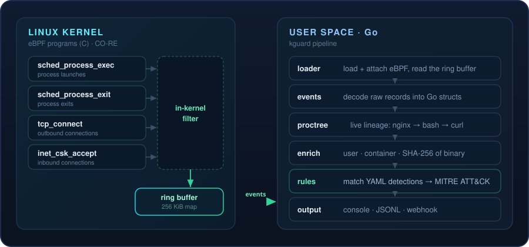

<div align="center">


<br>

**Watch what really happens on your Linux hosts - from inside the kernel.**

kguard uses eBPF to stream process, exec, and network activity in real time, enriches it with
identity and lineage context, and alerts on attacker behavior mapped to
[MITRE ATT&CK](https://attack.mitre.org/).

<br>

[](https://github.com/securewithharshitrajput/kguard/actions/workflows/ci.yml)


[Quickstart](#quickstart) · [Detections](#what-it-detects) · [How it works](#how-it-works) · [Why kguard](#why-kguard) · [Roadmap](#roadmap)

<br>


</div>

## Overview

Traditional log-based monitoring sees only what applications *choose* to report. kguard sits one
level deeper - in the **kernel**, via [eBPF](https://ebpf.io/) - so it observes the ground truth:
every program that launches, every process that exits, every TCP connection that opens. It filters
the noise in-kernel, enriches each event with **who / what / where** context, and evaluates a
**data-driven ruleset** so you receive *alerts*, not a firehose.

It is a lightweight, readable, open counterpart to the behavioral engine inside commercial EDR
products - small enough to understand in an afternoon, capable enough to catch a reverse shell.

> [!IMPORTANT]
> kguard is a **defensive** tool. Run it only on systems you own or are authorized to monitor.
> It observes activity; it does not attack anything. Loading eBPF requires root (or
> `CAP_BPF` + `CAP_PERFMON`).

## Highlights

<table>
<tr>
<td width="33%" valign="top">

**Kernel-level telemetry**

<sub>Every `execve` and exit - PID, PPID, UID, executable path, and arguments, straight from the source.</sub>

</td>
<td width="33%" valign="top">

**Network visibility**

<sub>Outbound (`tcp_connect`) and inbound (`inet_csk_accept`) IPv4 flows with addresses and ports.</sub>

</td>
<td width="33%" valign="top">

**Rich enrichment**

<sub>Username, container ID (Docker / containerd / K8s), SHA-256 of the binary, and full process lineage.</sub>

</td>
</tr>
<tr>
<td valign="top">

**YAML detection engine**

<sub>Add detections without recompiling - each rule mapped to a MITRE ATT&CK technique.</sub>

</td>
<td valign="top">

**Pluggable outputs**

<sub>Colorized console, newline-delimited JSON for your SIEM, and Slack-compatible webhooks.</sub>

</td>
<td valign="top">

**Lightweight & portable**

<sub>In-kernel filtering + a 256 KiB ring buffer, and CO-RE so you build once and run across kernels.</sub>

</td>
</tr>
</table>

## Quickstart

```bash
# 1. Install the toolchain (Fedora / RHEL)
sudo dnf install -y clang llvm bpftool libbpf-devel golang

#    ...or Debian / Ubuntu
# sudo apt-get install -y clang llvm libbpf-dev linux-tools-common golang

# 2. Build (generates vmlinux.h, compiles the eBPF, builds the Go binary)
make build

# 3. Run it (needs root to load eBPF)
sudo ./bin/kguard run
```

Then, in a second terminal, fire the **harmless** demo triggers and watch the alerts appear:

```bash
./test/simulate.sh
```

## Sample output

```text
kguard 0.1.0 - loaded 10 rules from rules/default.yaml
kguard is running. Press Ctrl-C to stop.

EXEC  pid=48213 ppid=1322 user=www-data /usr/bin/curl [curl http://169.254.169.254/...]
CONN  pid=48213 comm=curl -> 169.254.169.254:80

>> ALERT [high] exec-from-tmp  T1059 | pid=48990 comm=xmr parent=bash user=www-data file=/tmp/.x/xmr
>> ALERT [high] webserver-spawns-shell  T1505.003 | pid=49001 comm=bash parent=nginx user=www-data file=/usr/bin/bash
>> ALERT [high] shell-makes-network-connection  T1059.004 | pid=49001 comm=bash user=www-data -> 10.0.0.9:4444
```

<details>
<summary>The same events as JSON (<code>--log kguard.jsonl</code>)</summary>

<br>

```json
{"time":"2026-10-14T15:52:03Z","rule":"webserver-spawns-shell","severity":"high","mitre":"T1505.003",
 "description":"A web server process launched an interactive shell.",
 "event":{"Kind":"exec","Pid":49001,"Ppid":1322,"Uid":33,"Comm":"bash",
          "Filename":"/usr/bin/bash","Username":"www-data","ParentComm":"nginx",
          "Ancestry":["nginx","systemd"],"ExeSHA256":"a1b2c3..."}}
```
</details>

## How it works

<div align="center">

</div>

Events are filtered **in the kernel** so a busy host does not flood user space - only the records
that matter cross the boundary, through a 256 KiB ring buffer. On the Go side, a small pipeline
maintains a live process tree (so it knows `nginx → bash → curl`), enriches identity and container
context, evaluates the ruleset, and fans out to the configured sinks.

## What it detects

Every rule maps to a [MITRE ATT&CK](https://attack.mitre.org/) technique:

| Rule | Severity | MITRE | Catches |
|------|----------|-------|---------|
| `webserver-spawns-shell` | High | T1505.003 | Web shell / RCE |
| `exec-from-tmp` | High | T1059 | Malware run from `/tmp`, `/dev/shm` |
| `shell-makes-network-connection` | High | T1059.004 | Reverse shell |
| `download-piped-to-shell` | High | T1105 | `curl ... \| sh` |
| `read-etc-shadow` | Critical | T1003.008 | Credential dumping |
| `modify-authorized-keys` | High | T1098.004 | SSH backdoor |
| `modify-persistence` | Medium | T1053 | Cron / systemd persistence |
| `connect-to-mining-pool-port` | Medium | T1496 | Crypto miner |
| `suspicious-discovery-tooling` | Medium | T1046 | Recon tools (nmap, pspy...) |
| `exec-deleted-or-memfd` | High | T1620 | Fileless execution |

<details>
<summary>Writing your own rules</summary>

<br>

Rules live in [`rules/default.yaml`](rules/default.yaml). Within a field, a list means **OR**;
across fields it is **AND**. No recompile is needed - validate with `kguard rules test`.

```yaml
- id: webserver-spawns-shell
  description: A web server process launched an interactive shell.
  severity: high
  mitre: T1505.003
  match:
    event: exec
    parent_comm: [nginx, apache2, httpd, php-fpm]
    comm: [sh, bash, dash, zsh]
```

**Match fields:** `event`, `comm`, `parent_comm`, `ancestor`, `user`, `not_user`,
`file_prefix`, `file_contains`, `args_contains`, `dst_port`, `min_uid`, `max_uid`.
</details>

## Why kguard

kguard is intentionally small and readable - an effective way to *understand* how modern eBPF
security tooling works, and a solid base to build on. An honest positioning next to the
production heavyweights:

| | kguard | Falco | Tetragon |
|---|:---:|:---:|:---:|
| eBPF + CO-RE | ✓ | ✓ | ✓ |
| Readable in an afternoon | ✓ | ✗ | ✗ |
| Single static binary | ✓ | partial | partial |
| YAML rules → MITRE | ✓ | ✓ | partial |
| Enforcement / blocking | roadmap | partial | ✓ |
| Battle-tested at scale | ✗ | ✓ | ✓ |

Use Falco or Tetragon in production; use **kguard** to learn, prototype detections, and run
lightweight monitoring where a full stack is overkill.

## Run flags

| Flag | Default | Meaning |
|------|---------|---------|
| `--rules` | `rules/default.yaml` | Path to the detection ruleset |
| `--log` | *(none)* | Write JSONL events/alerts to this file |
| `--webhook` | *(none)* | POST alerts to this URL (Slack-compatible) |
| `--alerts-only` | `false` | Print only alerts to the console |
| `--no-hash` | `false` | Skip SHA-256 of executables (lower overhead) |

## Requirements

- Linux kernel **5.8+** with BTF (`/sys/kernel/btf/vmlinux` present) - Fedora, Ubuntu 20.10+,
  Debian 11+, and RHEL 9 all qualify.
- Build toolchain: `clang`, `llvm`, `bpftool`, `libbpf-devel`, Go **1.23+**.
- Root (or `CAP_BPF` + `CAP_PERFMON`) to run.

## Project layout

```
kguard/
├── bpf/
│   ├── common.h          event structs shared by C and Go
│   ├── kguard.bpf.c      kernel-side eBPF programs
│   └── vmlinux.h         generated from kernel BTF (make vmlinux)
├── cmd/kguard/main.go    CLI entry point
├── internal/
│   ├── loader/           load + attach eBPF, expose ring buffer
│   ├── events/           decode raw records into Go structs
│   ├── proctree/         live process lineage
│   ├── enrich/           user / container / hash enrichment
│   ├── rules/            YAML detection engine
│   └── output/           console / JSONL / webhook sinks
├── rules/default.yaml    shipped detections
├── test/simulate.sh      harmless triggers for every rule
└── .github/workflows/    CI
```

## Roadmap

- [ ] File-open monitoring via the **BPF LSM** hook (sensitive paths only)
- [ ] **Blocking mode** - deny exec from `/tmp` live via BPF LSM
- [ ] Per-event rate limiting and in-kernel allowlists
- [ ] Prometheus metrics endpoint
- [ ] Central collector for fleets of hosts

## Contributing

Issues and pull requests are welcome - new detection rules especially. Please run `make build`
and `./bin/kguard rules test` before opening a PR.

## License

Go code: **MIT**. eBPF C (`bpf/`): **GPL-2.0** (required for GPL-only kernel helpers).
See [LICENSE](LICENSE).

---

<div align="center">
<sub>If kguard taught you something or saved you a late night, a star is appreciated.</sub>
</div>
